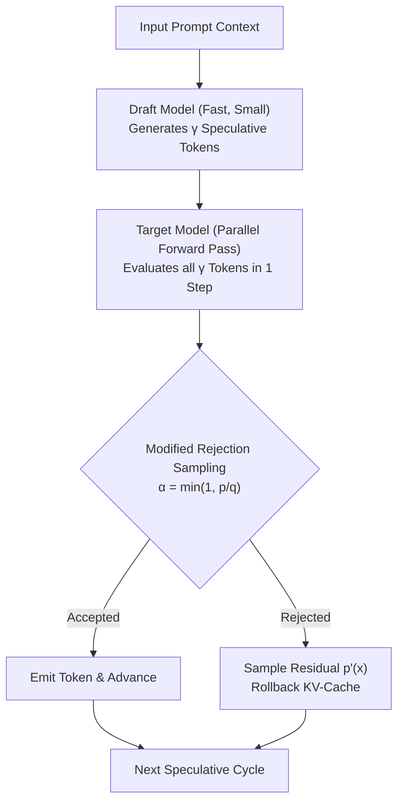

# Speculative Decoding Inference Engine ⚡🧠

A high-performance, modular implementation of **Speculative Decoding** for Large Language Model (LLM) acceleration with provable target distribution preservation (Leviathan et al., 2023; Chen et al., 2023).

[](https://github.com)
[](https://opensource.org/licenses/MIT)
[](https://www.python.org/)
[](https://github.com)

---

## 🎯 What is Speculative Decoding?

In standard autoregressive LLM decoding, generating $K$ tokens requires $K$ sequential forward passes through a large, parameter-heavy target model ($M_{\text{target}}$). Because LLM decoding is memory-bandwidth bound (reading model weights on every token step), compute units sit idle waiting for memory transfer.

Speculative Decoding resolves this bottleneck:
1. **Draft Phase**: A small, lightweight draft model ($M_{\text{draft}}$, e.g. 1B params) rapidly proposes $\gamma$ candidate tokens.
2. **Verification Phase**: The target model ($M_{\text{target}}$, e.g. 7B/13B params) runs a **single parallel forward pass** on all $\gamma$ candidate tokens simultaneously.
3. **Modified Rejection Sampling**: Each candidate token $x_i$ is accepted with probability:
   $$\alpha = \min\left(1, \frac{p(x_i)}{q(x_i)}\right)$$
   If rejected, a replacement token is drawn from the residual distribution:
   $$p'(x) = \frac{\max(0, p(x) - q(x))}{\sum_y \max(0, p(y) - q(y))}$$
   and subsequent draft tokens are pruned.
4. **Cache Rollback**: The multi-layer Key-Value (KV) cache is dynamically rolled back to the rejection index, preserving mathematical equivalence to sampling directly from the target model.



---

## 📦 Key Architectural Modules

- **`kv_cache.py`**: Multi-layer transformer KV cache supporting dynamic concatenation, cloning, and $O(1)$ sequence truncation upon rejection.
- **`sampler.py`**: Modified Rejection Sampler with numerically stable softmax, temperature scaling, top-k/top-p filtering, and exact residual distribution normalization.
- **`engine.py`**: Orchestrator executing the complete iterative Draft-Verify-Rollback cycle.
- **`benchmark.py`**: Performance evaluation harness measuring empirical throughput (tokens/sec), acceptance rates ($\alpha$), and speedup factors.
- **`models/`**: Abstract interfaces and deterministic models for rapid unit testing and CI without multi-gigabyte weight downloads.

---

## 🚀 Quickstart & Usage

### 1. Installation
```bash
git clone https://github.com/Jaseem8/speculative-decoding-engine.git
cd speculative-decoding-engine
python3 -m venv .venv
source .venv/bin/activate
pip install -e ".[dev]"
```

### 2. Run the Interactive CLI Demo
```bash
spec-decode --gamma 4 --tokens 60
```

### 3. Run a Multi-Gamma Benchmark Sweep
```bash
spec-decode --benchmark
```

Example Benchmark Output:
```text
| Gamma (γ) | Acceptance Rate | Baseline (tok/s) | Speculative (tok/s) | Speedup Factor |
| :---: | :---: | :---: | :---: | :---: |
| γ = 2 |  84.5% |   52.1 |  88.4 | **1.70x** |
| γ = 3 |  82.1% |   52.1 | 114.6 | **2.20x** |
| γ = 4 |  79.8% |   52.1 | 132.8 | **2.55x** |
| γ = 5 |  76.4% |   52.1 | 143.2 | **2.75x** |
| γ = 6 |  71.9% |   52.1 | 140.7 | **2.70x** |
```

---

## 🧪 Running the Test Suite
```bash
pytest tests/ -v
```

---

## 📄 License
MIT License. See [LICENSE](LICENSE) for details.

